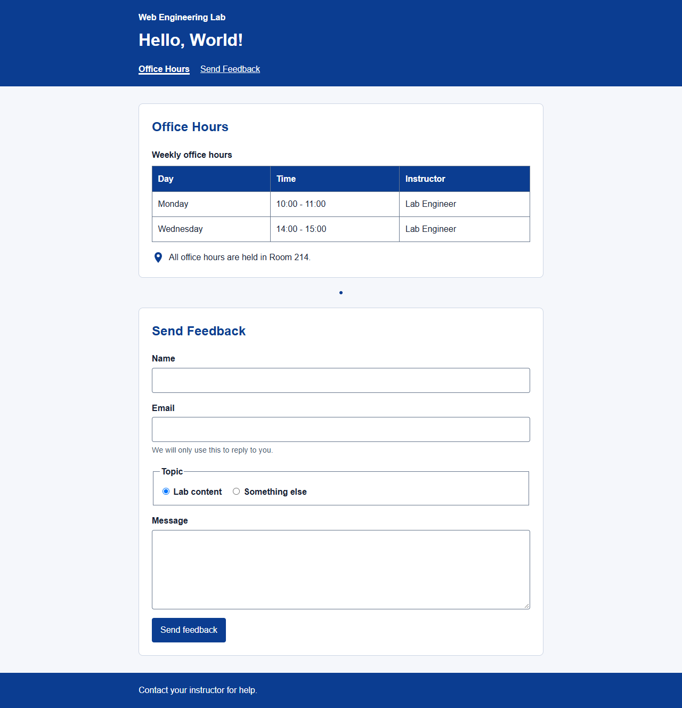

# Web Engineering Lab Report

## Lab 01: Development Environment Setup

**Student:** Ziaullah Khan  
**Roll number:** 2330-0145  
**Degree:** BS Artificial Intelligence (BS AI)  
**Course:** Web Engineering

### Objective

Set up a basic web-development environment, organize the project files, create a webpage that displays a greeting, and verify the greeting function with an automated test.

### Tools and technologies

Node.js, npm, Visual Studio Code, Git, HTML, CSS, JavaScript, ESLint, Prettier, `serve`, and Node's built-in test runner.

### Tasks and implementation

| Task                                 | Implementation                                                                                                                   |
| ------------------------------------ | -------------------------------------------------------------------------------------------------------------------------------- |
| Prepare the development environment  | Used Node.js and npm for JavaScript and package commands, VS Code for editing, and Git for version control.                      |
| Create the project structure         | Organized the webpage in `public/` and its automated test in `tests/`. Added project configuration, README, and editor settings. |
| Configure project commands and tools | Added ESLint, Prettier, and `serve` as development dependencies. Configured `test`, `lint`, `format`, and `start` npm scripts.   |
| Build the starter webpage            | Created `public/index.html`, `public/styles.css`, and `public/script.js`; the page displays “Hello, World!”.                     |
| Implement and test the greeting      | Implemented `greet(name)` in `public/script.js` and added a Node test in `tests/greet.test.js` for `greet("World")`.             |

### Concepts applied

`package.json` stores dependencies and repeatable project commands. A JavaScript function accepts a name and returns a greeting string. The same function is used by the webpage and imported by the test. ESLint checks JavaScript rules; Prettier checks consistent formatting.

### Results and evidence

The greeting test passed (1 test, 0 failures). ESLint and Prettier checks completed successfully. The starter greeting was retained in the semantic page used for Lab 02; its screenshot is included in the [Lab 02 report](Lab-02-Documentation.md#results-and-evidence). No separate Lab 01 screenshot was available.

### Conclusion

The project has a usable Node.js development setup, an organized folder structure, a working greeting page, and an automated test for the greeting function.
