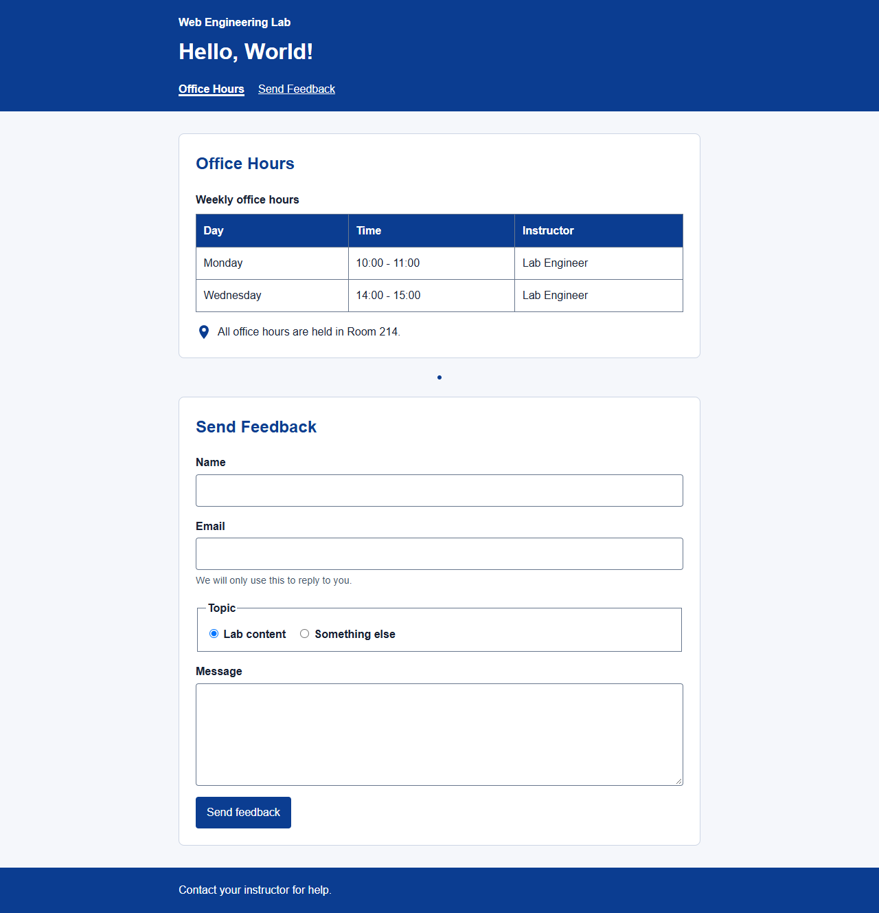
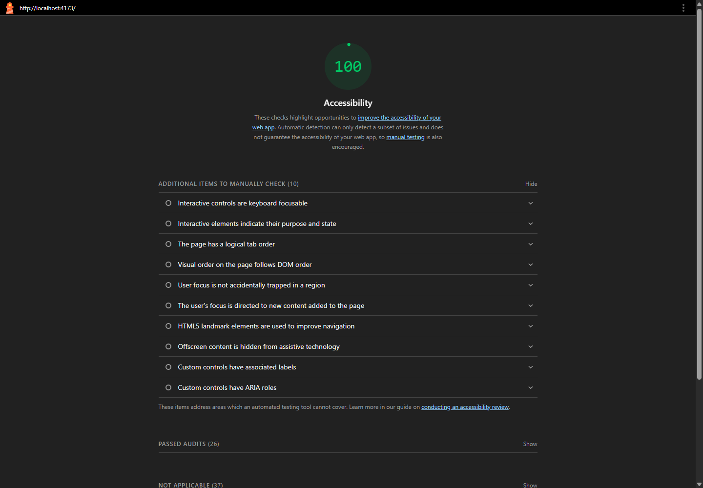

# Web Engineering Lab Report

## Lab 02: Semantic HTML and Accessibility

**Student:** Ziaullah Khan  
**Roll number:** 2330-0145  
**Degree:** BS Artificial Intelligence (BS AI)  
**Course:** Web Engineering

### Objective

Extend the Lab 01 webpage with semantic HTML and accessibility features for page navigation, tabular data, graphics, forms, and keyboard users.

### Tools and technologies

HTML5, CSS, JavaScript, Chrome, axe-core, and Lighthouse.

### Tasks and implementation

| Task                                 | Implementation                                                                                                                                                                                         |
| ------------------------------------ | ------------------------------------------------------------------------------------------------------------------------------------------------------------------------------------------------------ |
| Preserve the Lab 01 functionality    | Kept the `h1` greeting and loaded the existing greeting script with `defer`.                                                                                                                           |
| Add semantic page structure          | Added a skip link, `header`, list-based `nav`, one `main`, labelled sections, and a `footer` with an `address`.                                                                                        |
| Present office hours accessibly      | Used a table caption, `thead`, `tbody`, column headers with `scope="col"`, and `time` elements with machine-readable values.                                                                           |
| Describe images appropriately        | Marked the decorative SVG as hidden from assistive technology. Gave the informative location SVG an accessible name and placed it in a `figure` with a `figcaption`.                                   |
| Create an accessible feedback form   | Associated labels with required inputs, connected the email hint with `aria-describedby`, grouped radio buttons in a `fieldset` with a `legend`, and added a labelled message field and submit button. |
| Identify the current navigation item | Used `aria-current="location"` on the Office Hours link.                                                                                                                                               |
| Make keyboard focus visible          | Added a skip link that appears on focus and a 3px `:focus-visible` outline for interactive controls.                                                                                                   |

### Concepts applied

Landmarks make major page regions easier to locate. Native semantic elements provide built-in relationships, such as table headings and form labels. ARIA supplements native HTML when an additional accessible state or name is needed. Visible focus styling helps keyboard users track their position.

### Results and evidence

The page was checked for keyboard navigation, focus visibility, and automated accessibility. The recorded results were eight Tab stops, visible 3px focus outlines, zero axe-core violations, and a Lighthouse Accessibility score of 100. Automated checks do not replace manual assistive-technology testing.

### Conclusion

The Lab 01 greeting page was extended with semantic structure and accessible table, image, form, and keyboard patterns.
