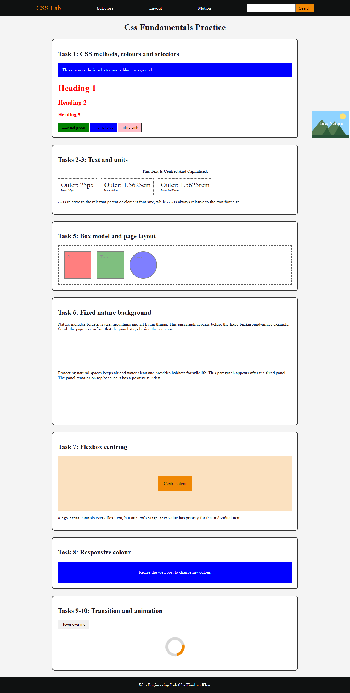

# Lab 03: CSS Fundamentals - Styling, Layout and Animation

**Student:** Ziaullah Khan  
**Roll number:** 2330-0145  
**Degree:** BS Artificial Intelligence (BS AI)  
**Course:** Web Engineering

## Objective

Practise the main ways CSS controls selectors, colours, text, units, the box model, layout, positioning, responsive design, transitions, transforms, and animation.

## Tools and technologies

- HTML5 and CSS3
- VS Code with Live Server
- Chrome headless browser for viewport and computed-style checks

## Tasks performed

1. Demonstrated external, internal, and inline CSS; id and class selectors; and the required blue, red, green, blue, and pink styling.
2. Set the document to Times New Roman and created centred, capitalised text.
3. Compared equivalent `px`, `em`, and `rem` nested font sizes and explained their reference points.
4. Built a 60px Flexbox navbar with the exact dark background, orange logo and search button, three links, and evenly spaced single-line content.
5. Created three bordered 100px boxes with different colours and 0.5 opacity; the final box is circular.
6. Placed a fixed “Love Nature” background-image panel on the right with `z-index: 10`.
7. Centred a child using Flexbox and explained that `align-self` overrides `align-items` for one item.
8. Added the four required responsive colour ranges.
9. Added a hover transition that increases button text to 24px and rotates it 5 degrees.
10. Added an infinitely spinning circular loader with one coloured border side.

## Important code concepts

The cascade determines which declaration wins: inline CSS overrides internal and external rules in this example. Relative units adapt to another size, Flexbox aligns items on two axes, and media queries apply rules only within specified viewport ranges. Transitions animate a state change, while keyframes can repeat an animation independently.

## Results

Browser checks confirmed:

- 280px viewport: green responsive box
- 350px viewport: pink responsive box
- 500px viewport: red responsive box
- 700px viewport: blue responsive box
- Hover state: font size changed to 24px and the rotation transform applied
- Loader animation name: `spin`
- Nature panel: fixed position with z-index 10
- Flex child: centred on both axes

## Conclusion

All ten activities are collected in one straightforward page that can be opened with Live Server and inspected in DevTools.

## Viva preparation

**What is the difference between `em` and `rem`?**  
`em` depends on a relevant parent or element font size; `rem` always depends on the root font size.

**What does `z-index` control?**  
It controls the stacking order of positioned elements.

**Which has priority: `align-items` or `align-self`?**  
`align-self` overrides the parent's `align-items` value for one flex item.

**How is a transition different from an animation?**  
A transition animates between states such as normal and hover; a keyframe animation can run through multiple stages and repeat automatically.
