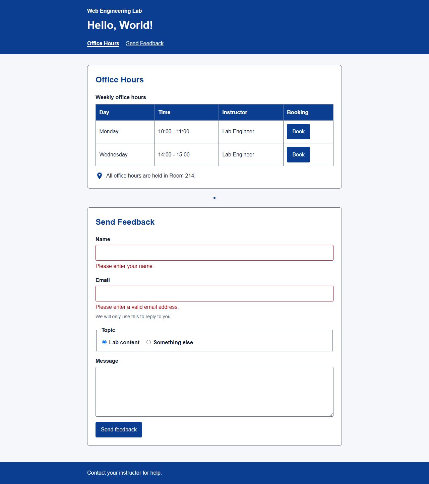
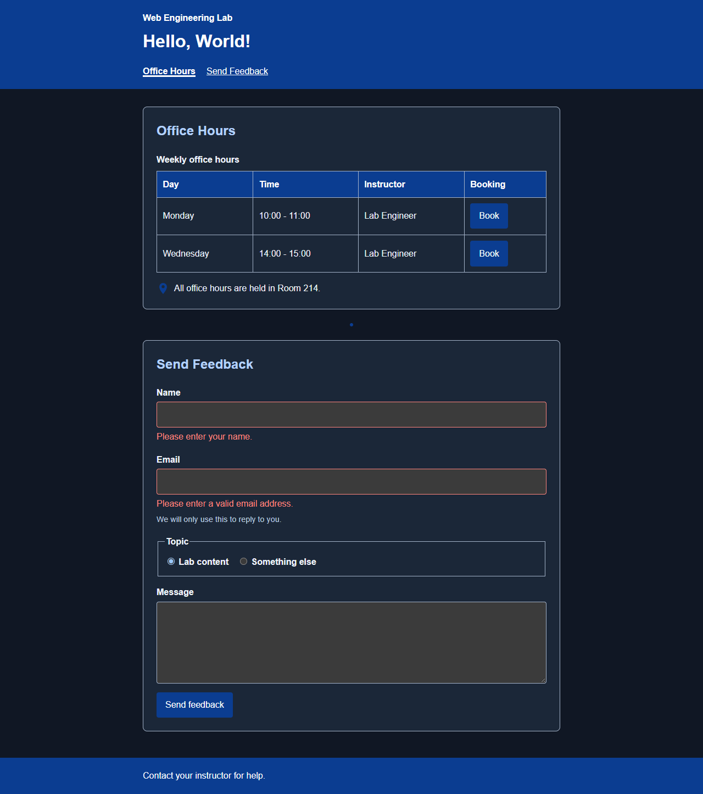
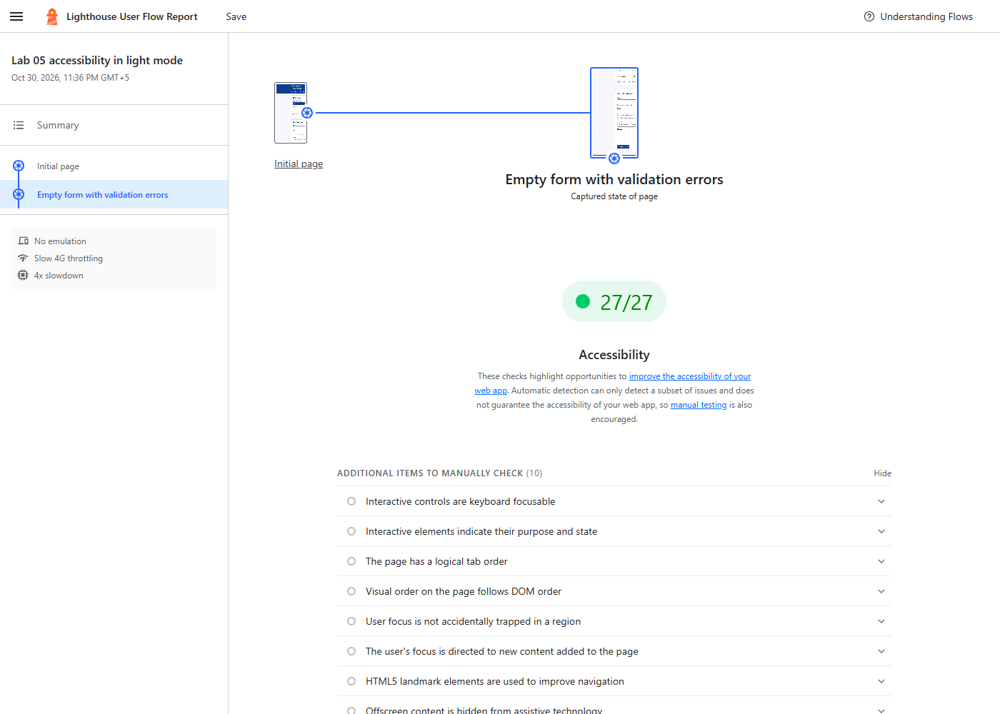
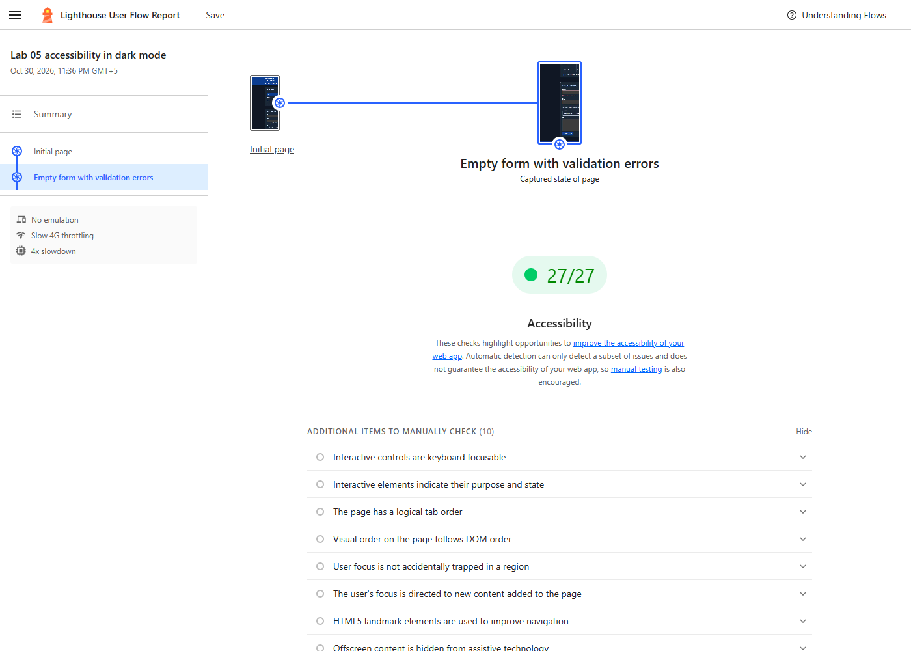

# Web Engineering Lab 05 Report

## Legacy jQuery migration and TypeScript foundations

**Student:** Ziaullah Khan  
**Roll number:** 2330-0145  
**Degree:** BS Artificial Intelligence  
**Course:** Web Engineering  
**Date:** 30 October 2026  
**Repository:** [1Zia/web-engineering-lab](https://github.com/1Zia/web-engineering-lab)

## Objective and result

Port a legacy jQuery feedback validator to native JavaScript while preserving its validation behavior, then move the application to strict TypeScript. The final page supports accessible inline feedback errors and keyboard operated office-hours booking. All four unit tests and four browser tests pass. Lighthouse accessibility scores are 100 for the initial page and empty-form error state in both light and dark modes.

The starting repository contained Labs 01–03 rather than the Lab 04 modules referenced by the statement. The missing office-hours booking behavior and shared utilities were added within this lab, while the existing greeting, accessible HTML and separate CSS lab were retained.

## Tools and project structure

Node.js and npm manage TypeScript, ESLint, Prettier, Playwright and Lighthouse. Chrome runs the browser checks. jQuery 3.7.1 was loaded from its pinned CDN only for the legacy stage. The final application uses no third party runtime library.

```text
src/
  main.ts       typed booking events and greeting
  feedback.ts   native feedback validation
  utils.ts      Slot interface and shared typed helpers
public/
  index.html    semantic page with module scripts and novalidate
  styles.css    layered component styles and light and dark tokens
  main.js       generated browser module
  feedback.js   generated browser module
  utils.js      generated browser module
  package.json  declares generated JavaScript as ES modules for Node tests
tests/
  greet.test.js
  utils.test.js
  browser/lab05.spec.js
docs/
  Lab-05-Statement.docx
  Lab-05-Documentation.md
  evidence/
  screenshots/
LEGACY-NOTES.md
tsconfig.json
```

Edit the TypeScript source files, then build. Generated JavaScript is committed so Live Server can also serve the page directly. Browser imports use `.js` extensions because browsers load compiled JavaScript, not TypeScript.

## Completion of the twelve activities

| Task | Implementation and evidence                                                                                                                                                                                                                                                  |
| ---- | ---------------------------------------------------------------------------------------------------------------------------------------------------------------------------------------------------------------------------------------------------------------------------- |
| 1    | Added `novalidate` and tested the supplied jQuery 3.7.1 validator. Empty submission produced two errors; a valid trimmed name displayed the acknowledgement and reset the form. The browser recorded the pinned CDN request. Legacy source is preserved in commit `133838b`. |
| 2    | Added the six native translations and three legacy smells in [LEGACY-NOTES.md](../LEGACY-NOTES.md).                                                                                                                                                                          |
| 3    | Created the native feedback port, replaced the CDN and legacy script tags with module scripts, and removed the legacy file. Browser checks confirm no jQuery or legacy script request.                                                                                       |
| 4    | Added the specified `--color-error` token and `.error` and invalid-input rules inside the components layer. Error messages have `role="alert"`; fields use `aria-invalid` and associated descriptions.                                                                       |
| 5    | Installed TypeScript and added `build`, `typecheck` and the required strict compiler configuration.                                                                                                                                                                          |
| 6    | Moved the browser code into `src/` with Git moves. Recorded initial nullability and implicit-any diagnostics in the legacy notes.                                                                                                                                            |
| 7    | Typed `delay`, `makeCounter` and the generic `getRequired<T extends Element>` helper.                                                                                                                                                                                        |
| 8    | Added `Slot` and `describeSlot`. Verified that a variable with an extra `id` property compiles, while an incomplete slot reports TS2739.                                                                                                                                     |
| 9    | Typed the booking handler and narrowed `event.target`, `closest()` results and the result of `find()` before use.                                                                                                                                                            |
| 10   | Typed feedback helper parameters and return values and replaced unchecked selectors with `getRequired`.                                                                                                                                                                      |
| 11   | Built all three browser modules. Changed the delay argument to a string, observed TS2345 and unchanged output files, then restored the number and passed type checking.                                                                                                      |
| 12   | Tested the form, keyboard booking and cancellation, mobile layouts, runtime errors and network requests. Saved Lighthouse reports and screenshots for all four accessibility checks.                                                                                         |

## Part A behavior and migration decisions

The validator intercepts submission, removes prior error elements, trims the name and email, and displays the two assigned messages when validation fails. A valid submission displays `Thanks, Zia! Your feedback was received.` for a name of Zia and resets the entire form. The jQuery fade is omitted as permitted by the statement.

Error elements are constructed with DOM methods and populated with `textContent`. Name content therefore appears as text even when it resembles HTML. The name and email errors are linked to their inputs through `aria-describedby`; the existing email hint remains linked after errors clear. Repeated invalid submissions do not accumulate duplicate error spans or description IDs.

The email rule deliberately remains `email.includes("@")`, matching the legacy validator. The textarea retains its `required` attribute, but the assigned custom validation checks only name and email. This exercise simulates feedback receipt locally; it does not send data to a server.





## Part B TypeScript design

The compiler targets ES2022 modules and the DOM libraries. `rootDir: "src"` and `outDir: "public"` separate editable sources from browser output. `strict: true` enables checks including implicit-any and nullability checks. `noEmitOnError: true` prevents a failing build from replacing the working JavaScript files.

`Slot` defines the shape of an office-hours record. `describeSlot(slot: Slot): string` formats that record, while `delay(ms: number): Promise<void>` models the asynchronous update. `makeCounter(): () => number` returns a closure that increments only when a booking is confirmed. Each new counter keeps its own state.

`getRequired<T extends Element>` returns the caller's expected DOM element type after checking for `null`. For example, `getRequired<HTMLInputElement>("#name", form)` allows safe use of `.value`. The generic type is a compile-time expectation; it does not check an element's actual tag at runtime, so selectors and markup must remain consistent.

The delegated booking listener starts by proving `event.target instanceof Element`. It returns when the clicked element has no booking button or row, or when no matching slot exists. The button is disabled during the one-second simulated update to prevent duplicate activations. Completion toggles the row, updates `aria-pressed`, and announces the booking count in a polite status region. Enter and Space activate the native button; clicking the nested span also reaches the delegated handler.

Type annotations, interfaces, generic arguments and the `type Slot` import disappear during compilation. The browser receives ordinary JavaScript. Runtime DOM checks, such as the missing-element guard, remain in the output.

## Compiler experiments

The initial migration produced real diagnostics including TS18047 for a possibly null form, TS7006 for an untyped input parameter, and TS2339 for accessing `.value` on a general `Element`. Typed helpers and annotations corrected them.

A temporary `booking` variable containing all four `Slot` properties plus `id: 1` compiled successfully. The call `describeSlot({ day: "Monday" })` failed with TS2739 because the other three properties were missing. The object with extra data is structurally compatible; the incomplete object is not.

Changing `delay(1000)` to `delay("1000")` produced TS2345. File hashes confirmed that the failed build did not change any compiled module. The incorrect call and temporary test file were removed, and the final type check passed. The [experiment transcript](evidence/Lab-05-TypeScript-Experiments.txt) records the actual diagnostics.

## Validation results

| Check                          | Observed result                                                                                                                                         |
| ------------------------------ | ------------------------------------------------------------------------------------------------------------------------------------------------------- |
| Strict type check and build    | Passed with no compiler diagnostics                                                                                                                     |
| Unit tests                     | 4 passed: greeting, counter closures, slot description and required-element behavior                                                                    |
| Browser tests                  | 4 passed: validator behavior, keyboard booking, light mobile layout and dark mobile layout                                                              |
| Form checks                    | Empty and malformed inputs show the expected messages; repeat submissions clear old errors; valid submission resets fields; HTML-like names remain text |
| Keyboard checks                | Tab reaches the skip link and booking controls; Enter books Monday; Space cancels it; booking count and pressed state update                            |
| Mobile checks                  | No horizontal page overflow at 390 pixels in either color mode                                                                                          |
| Runtime and network            | No JavaScript page errors; no jQuery or legacy-script requests                                                                                          |
| Light initial and error states | Lighthouse accessibility 100 for each state                                                                                                             |
| Dark initial and error states  | Lighthouse accessibility 100 for each state                                                                                                             |
| Dependency audit               | 0 vulnerabilities after updating the affected transitive package                                                                                        |

The accessibility run uses Lighthouse snapshots to inspect both the initial page and the form after error messages have appeared. It checks the actual error state instead of navigating back to a clean page. Automated scores are supplemented here by the browser's Tab, Enter and Space tests; no screen-reader test is claimed.





The [light report](evidence/Lab-05-Lighthouse-light.html), [dark report](evidence/Lab-05-Lighthouse-dark.html) and [machine-readable summary](evidence/Lab-05-Accessibility-Summary.json) are included. Download an HTML report and open it in a browser to interact with its results.

## Run and verify

```bash
npm ci
npm run typecheck
npm run build
npm test
npm run lint
npm run format
npm run test:e2e
npm start
```

Open `http://localhost:3000`. Browser tests use an installed Chrome browser through Playwright's `chrome` channel. With the server running in another terminal, `npm run audit:lab05` regenerates Lighthouse reports, JSON results and screenshots. The audit script defaults to the standard Windows Chrome path; set `CHROME_PATH` when Chrome is installed elsewhere. In PowerShell, use `npm.cmd` if local execution policy blocks `npm.ps1`.

To inspect the removed legacy version without changing the current working tree:

```bash
git show 133838b:public/legacy-feedback.js
git show 133838b:public/index.html
```

## Conclusion

The application preserves the legacy form's behavior using native DOM APIs and adds compile-time checks through TypeScript. Explicit types, null narrowing and a shared generic selector helper make assumptions visible before deployment. The saved diagnostics, browser tests and Lighthouse reports provide evidence for the completed activities.

## References and acknowledgement

- [Supplied Lab 05 statement](Lab-05-Statement.docx), source of the exercise and starter examples.
- [jQuery trim API](https://api.jquery.com/jQuery.trim/), removal of the legacy trim helper.
- [MDN JavaScript modules](https://developer.mozilla.org/en-US/docs/Web/JavaScript/Guide/Modules), native module loading and scope.
- [TypeScript compiler configuration](https://www.typescriptlang.org/tsconfig/), compiler checking and output settings.
- [Lighthouse user flows](https://github.com/GoogleChrome/lighthouse/blob/main/docs/user-flows.md), snapshot auditing of interactive states.

Implementation, documentation and automated checks were prepared with OpenAI Codex assistance. The instructor's starter examples were adapted and are acknowledged above.
